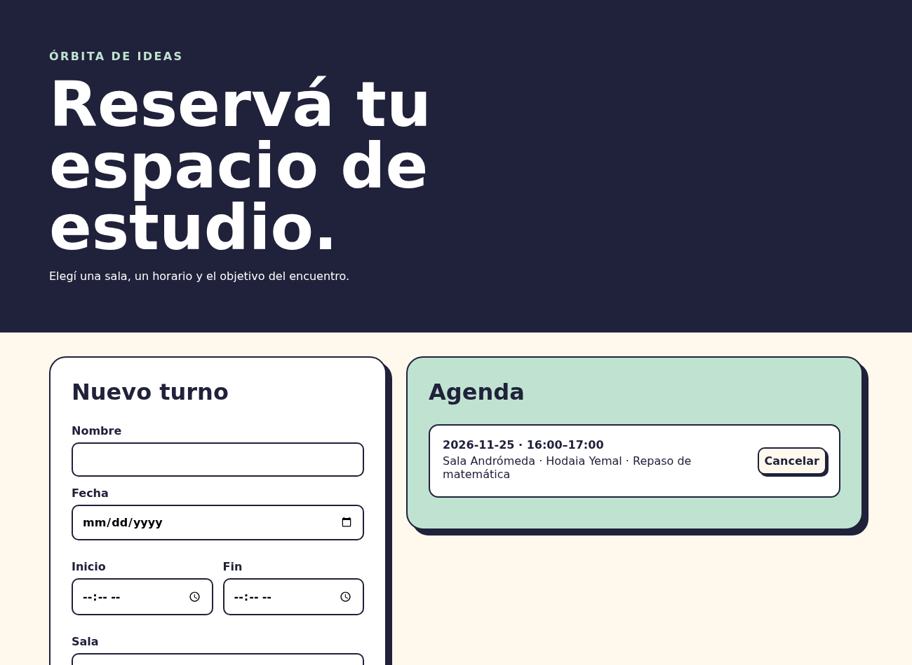
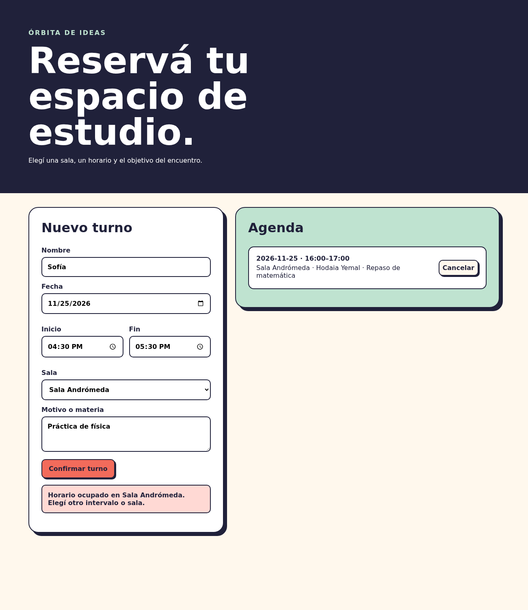
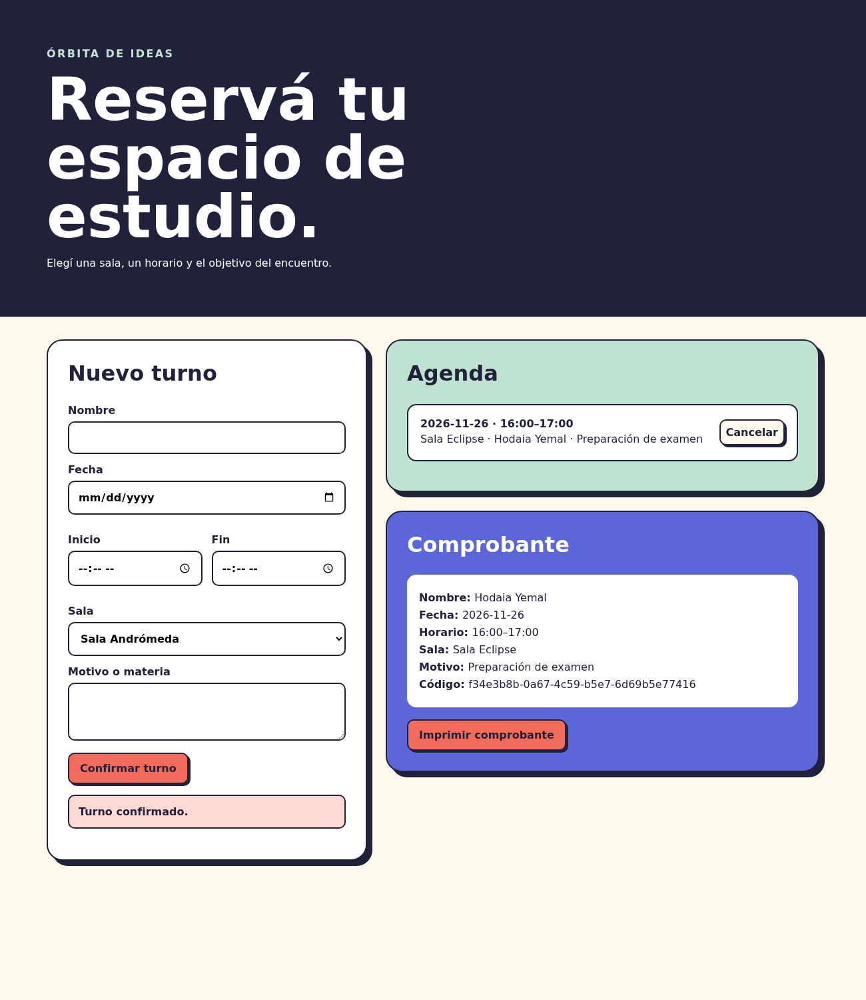

# Gestión de turnos — Órbita de Ideas

Sistema local para reservar salas de estudio, detectar superposiciones, cancelar turnos y emitir comprobantes imprimibles.

## Datos generales

- Estudiante: Hodaia Yemal
- Tecnologías: HTML, CSS, JavaScript y localStorage
- Sketch local: [`evidencias/sketch-turnos.drawio`](evidencias/sketch-turnos.drawio)
- Documentación completa: [`documentacion.md`](documentacion.md)

## Reglas

- Salas disponibles: Andrómeda, Eclipse y Nova.
- Se exige nombre, fecha, inicio, fin, sala y motivo.
- El fin debe ser posterior al inicio.
- Se aceptan horarios consecutivos y simultáneos en salas diferentes.
- Se rechaza una reserva cuando coincide fecha y sala y `nuevoInicio < finExistente && nuevoFin > inicioExistente`.
- Cancelar libera el intervalo.
- Una solicitud rechazada no conserva un comprobante anterior.

## Prompt utilizado

```text
Implementá el sistema de turnos de Órbita de Ideas en index.html, style.css y script.js. Incluí nombre, fecha, inicio, fin, sala y motivo; agenda ordenada; cancelación; comprobante imprimible y persistencia con la clave orbita-de-ideas:turnos:v1. Las salas son Andrómeda, Eclipse y Nova. Convertí horas a minutos y rechazá un turno cuando coincidan fecha y sala y nuevoInicio < finExistente y nuevoFin > inicioExistente. Aceptá intervalos consecutivos y el mismo horario en otra sala. Si se rechaza una solicitud, ocultá cualquier comprobante anterior. Validá almacenamiento corrupto, campos vacíos y fin posterior al inicio. Usá los IDs del sketch y diseño responsive y accesible.
```

## Pruebas

Se verificaron coincidencia exacta, superposición parcial, contención, turnos consecutivos, otra sala, otra fecha, horarios inválidos, cancelación, persistencia, orden y comprobante.

```bash
node --test tests/appointments.test.js
node --check script.js
```

## Evidencias







## Ejecución

Abrir `index.html` en el navegador. Los turnos se guardan localmente.
