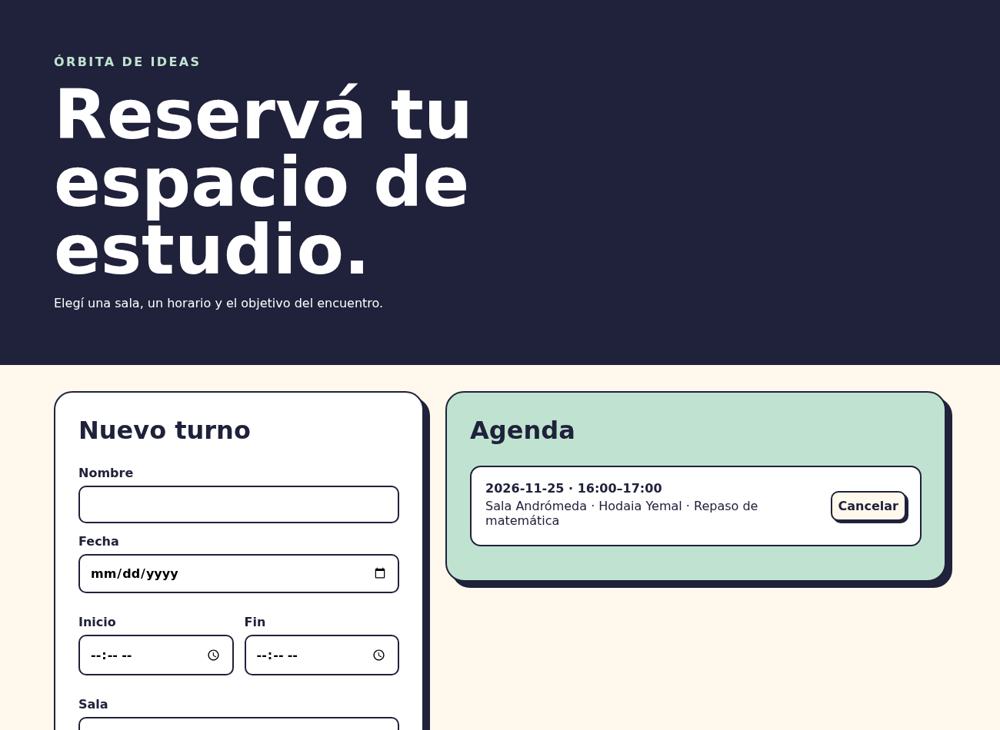
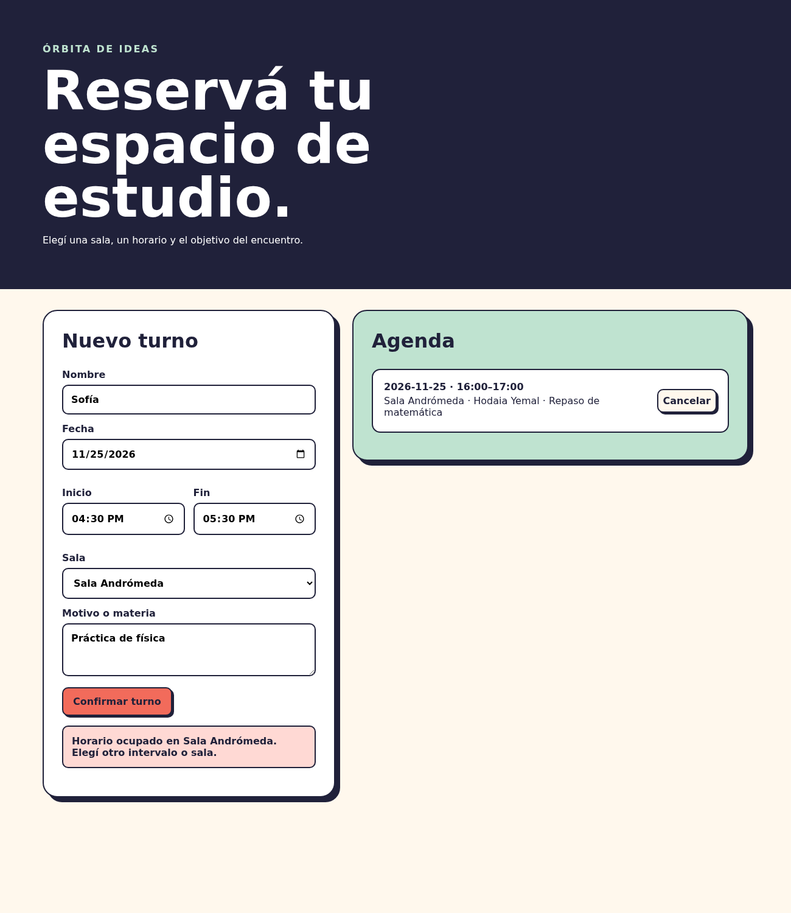
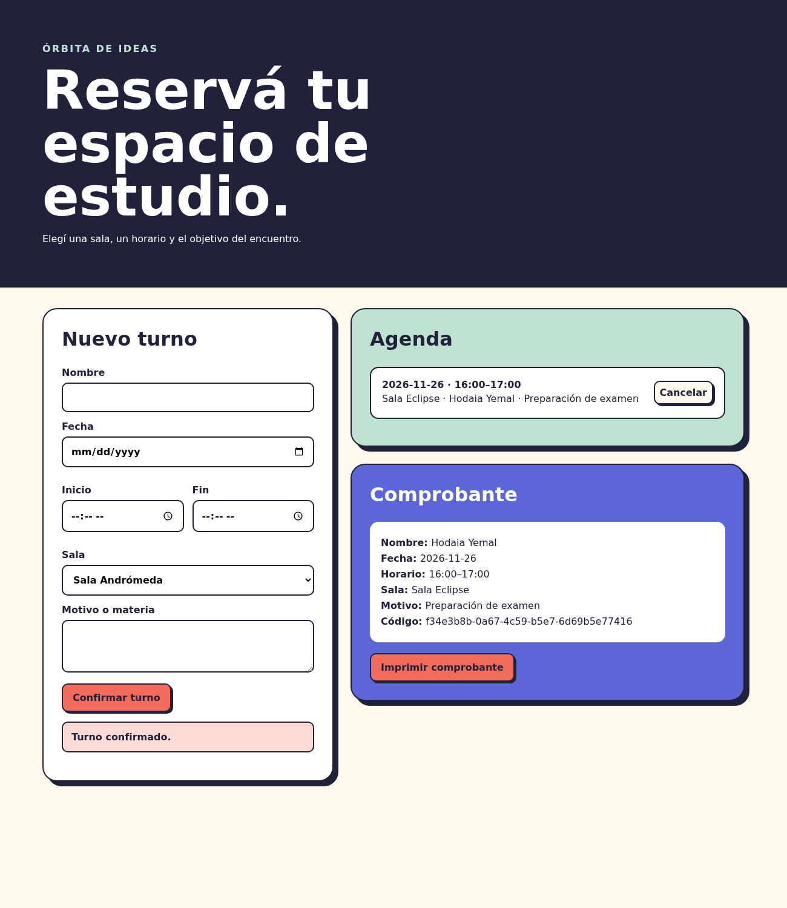

# Gestión de turnos — Órbita de Ideas

## Datos generales y sketch

- Estudiante: Hodaia Yemal
- Tecnologías: HTML, CSS, JavaScript y localStorage
- Repositorio: https://github.com/2023hodaiayemal-netizen/turnos-club-estudio
- Sketch previo: `evidencias/sketch-turnos.drawio` y `evidencias/sketch-turnos.png`

## Planeamiento

Se reservan Sala Andrómeda, Sala Eclipse o Sala Nova. Cada turno contiene id, nombre, fecha, inicio, fin, recurso y motivo. Los intervalos consecutivos se aceptan; las superposiciones se rechazan solo para la misma fecha y sala.

## Prompt inicial

```text
Implementá el sistema de turnos de Órbita de Ideas en index.html, style.css y script.js. Incluí nombre, fecha, inicio, fin, sala y motivo; agenda ordenada; cancelación; comprobante imprimible y persistencia con la clave orbita-de-ideas:turnos:v1. Las salas son Andrómeda, Eclipse y Nova. Convertí horas a minutos y rechazá un turno cuando coincidan fecha y sala y nuevoInicio < finExistente y nuevoFin > inicioExistente. Aceptá intervalos consecutivos y el mismo horario en otra sala. Si se rechaza una solicitud, ocultá cualquier comprobante anterior. Validá almacenamiento corrupto, campos vacíos y fin posterior al inicio. Usá los IDs del sketch y diseño responsive y accesible.
```

## Pruebas y versiones

Con un turno base de 16:00 a 17:00 para la misma fecha y sala se verificó:

| Solicitud | Resultado |
| --- | --- |
| 15:00–16:00 | Aceptada |
| 17:00–18:00 | Aceptada |
| 16:00–17:00 | Rechazada |
| 16:30–17:30 | Rechazada |
| 16:15–16:45 | Rechazada |
| 15:30–17:30 | Rechazada |
| 16:00–17:00 en otra sala | Aceptada |
| Mismo horario en otra fecha | Aceptada |

También se probaron campos vacíos, horarios fuera de rango, fin igual o anterior al inicio, cancelación, nueva reserva del intervalo liberado, persistencia, orden cronológico y comprobante correspondiente al último turno aceptado. Una solicitud rechazada oculta el comprobante anterior.

Comandos ejecutados: `node --test tests/appointments.test.js` y `node --check script.js`.

## Evidencias







## Estado

- [x] Sketch local
- [x] Reservas y conflictos
- [x] Cancelación y persistencia
- [x] Comprobante imprimible
- [x] Pruebas y evidencias
